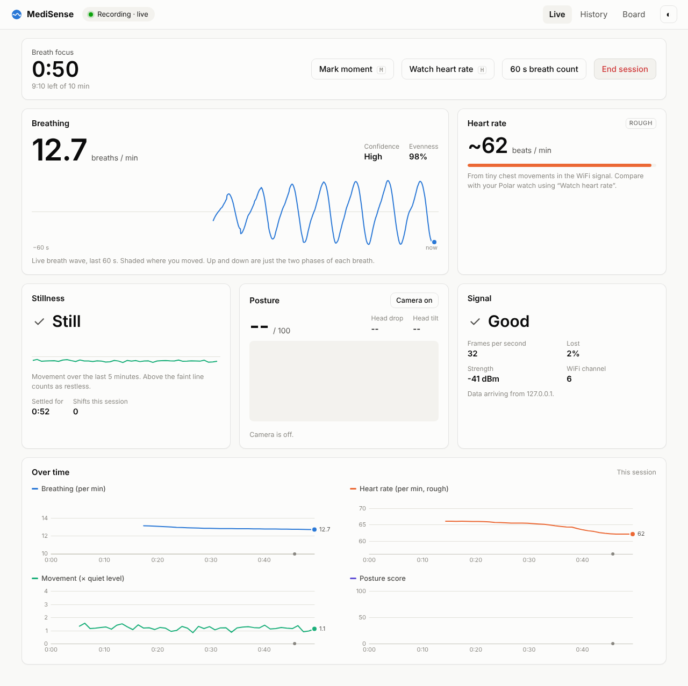
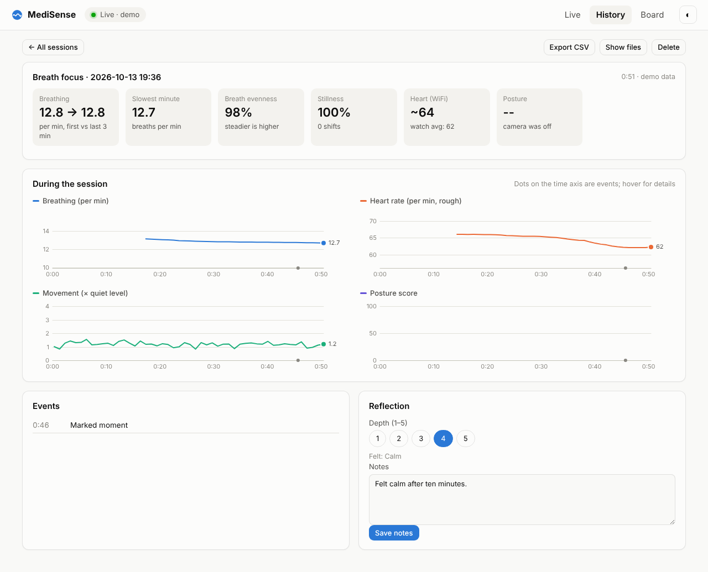

# MediSense

See your breathing, heart rate, stillness and posture change while you meditate,
without wearing anything. A small ESP32-S3 board (about $15) listens to how your
home WiFi signal bends around your body
([RuView](https://github.com/ruvnet/RuView) WiFi sensing). Your Mac turns that
into live numbers and charts in the browser, and records every session so you
can track your progress.



Everything stays on your Mac. Nothing is uploaded anywhere, and the optional
webcam video never leaves your browser.

---

## 1. What you need

- **An ESP32-S3 board**: Espressif **ESP32-S3-DevKitC-1 N16R8** (or N8R8). See
  [docs/HARDWARE.md](docs/HARDWARE.md) for exact models and what to avoid.
- **A USB data cable that fits your Mac.** A MacBook Pro 2014 has the large,
  rectangular USB-A ports, so you need a **USB-A to USB-C data cable** (for
  newer DevKitC boards; older ones use micro-USB). Charge-only cables don't
  work.
- **WiFi with a 2.4 GHz network**. Almost every home router has one. The Mac
  must be on the same WiFi.
- Optional: your Polar watch, to check the heart rate against.

You can install and try MediSense **before the board arrives** (demo mode).

## 2. Install (once)

1. Log in to GitHub in your browser, open
   [github.com/roman-spix/medisense](https://github.com/roman-spix/medisense),
   click the green **Code** button, then **Download ZIP**. Safari unzips it into
   your Downloads folder.
2. Open **Terminal** (press ⌘-Space, type *Terminal*, press Return) and paste:

   ```
   bash ~/Downloads/medisense-main/install.sh
   ```

   If the folder in Downloads has a different name, type `bash ` and drag the
   `install.sh` file from that folder into the Terminal window, then press Return.

If macOS asks whether Terminal may access files in your Downloads (or later
Desktop) folder, click **OK**. The installer takes a few minutes. It needs no
administrator password and installs nothing system-wide:

- it moves MediSense to `~/Applications/MediSense`
- it installs its own private Python, leaving the Mac's old one alone
- it puts two icons on your Desktop: **MediSense** and **MediSense Demo**

(Alternative: double-click **Install MediSense.command** in the folder. If macOS
says it can't be opened, right-click it, choose **Open**, then **Open** again.)

## 3. Try the demo

Double-click **MediSense Demo** on the Desktop. A Terminal window opens (keep it
open; closing it quits MediSense) and the dashboard opens in your browser at
`http://localhost:8765`. A simulated meditator breathes slower and slower, and
shifts position now and then. Start a session, press **M** to mark a moment, end
it, and look at the History tab.

## 4. First time with the board

1. Double-click **MediSense** on the Desktop.
2. Plug the board into the Mac. On a DevKitC either USB port works; the one
   labelled **USB** needs no driver.
3. MediSense finds the board within a few seconds and asks for your WiFi
   password. The WiFi name is filled in from what your Mac uses. Click
   **Set up board**.
4. It installs the firmware (about a minute, only once per board), restarts the
   board, and waits for it to join your WiFi. When the data arrives, the badge at
   the top turns green: **Live**.

From then on it's plug and play: plug the board in, open MediSense, and it's
live within seconds. The board can also run from any USB phone charger
elsewhere in the room. The data travels over WiFi, and USB is only needed for
setup.

If something goes wrong, MediSense says what and how to fix it (wrong password,
a 5 GHz-only network, the macOS firewall…). The **Board** tab shows details and
the board's own log.

## 5. Meditating with MediSense

- **Place the board 1–2 m from you**, about chest height, ideally with you
  between the board and the router. Sit still for the first ~20 seconds while it
  learns your breathing.
- On the Live tab, choose the practice and duration, optionally an intention,
  and tick **Track posture with the webcam** if you like. Click **Start session**.
  A soft bell rings at the start, and again when the time is up.
- During the session:
  - **Mark moment** (key **M**): note when something happened, such as
    drowsiness, a breakthrough or a distraction.
  - **Watch heart rate** (key **H**): type what your Polar shows. Later you can
    compare it with the WiFi estimate.
  - **60 s breath count**: count your breaths for a minute, as a check of the
    breathing number.
- **End session**: rate the depth (1–5), how you feel, the Polar average and
  notes. You then see the session summary.

What the numbers mean:

| Card | What it shows | How reliable |
|---|---|---|
| Breathing | Breaths per minute, a live breath wave, how even your breaths are | Good when you sit still |
| Heart rate | Beats per minute from tiny chest movements | Rough: compare it with your watch |
| Stillness | Still / restless / moving, how long you've been settled, number of shifts | Good |
| Posture | Score 0–100 from the webcam: head drop (slumping), head and shoulder tilt vs. your upright start | Good when your head and shoulders are in view |
| Signal | How much data the board delivers | n/a |

The **History** tab shows progress across sessions (minutes, breathing at the end,
stillness, posture) and every session in detail.



## 6. Your data

Each session is a folder in `~/MediSense/sessions/` (**Show files** in the
History tab opens it):

| File | Contents |
|---|---|
| `session.json` | Date, practice, intention, rating, notes, summary numbers |
| `metrics.csv` | One row per second: breathing, heart rate, movement, posture (opens in Numbers/Excel) |
| `wave.csv` | Breath wave and movement, 10 rows per second |
| `posture.csv` | Webcam posture measurements (angles only, no images) |
| `events.jsonl` | Shifts, marks, watch readings, breath counts |
| `raw.mscap.gz` | Everything the board sent, so sessions can be re-analysed with better algorithms later (`medisense reprocess <session>`) |

Deleting a session in the app moves it to `~/MediSense/trash`.

## 7. Troubleshooting

| What you see | What to do |
|---|---|
| "No board" though it's plugged in | Try the other USB port on the board or another cable (some are charge-only). |
| "The board didn't answer" while setting up | Hold **BOOT** on the board, press and release **RESET**, release **BOOT**, then unplug and replug. |
| "The WiFi password seems to be wrong" | Type it again in the form shown. Passwords are case-sensitive. |
| "Can't find that WiFi network" | The board needs 2.4 GHz. If your router names 2.4 and 5 GHz differently, pick the 2.4 GHz name. |
| "On WiFi but no data reaches this Mac" | Same WiFi on the Mac? macOS firewall: System Preferences → Security & Privacy → Firewall. Allow Python, or turn off "Block all incoming connections". |
| Signal "Weak" | Move the board closer to the router, away from metal and other electronics. |
| Breathing shows "--" for long | Sit still. Move the board so your chest is between it and the router. |
| Camera posture doesn't start | Allow the camera when the browser asks. Safari: Safari → Settings for This Website → Camera. Chrome also needs System Preferences → Security & Privacy → Camera. |
| macOS asks if "python3.12" may accept incoming connections | Click **Allow**: that's the board's data arriving. |

Run a self-check any time in Terminal: `~/Applications/MediSense/.venv/bin/medisense doctor`

## 8. Updating and removing

**Update:** download the new ZIP and run `install.sh` from it again, the same way
as installing. Your recordings and board setup are kept.

**Remove:** delete `~/Applications/MediSense`, `~/.medisense` and the two
Desktop icons. Your recordings stay in `~/MediSense` until you delete that too.

## 9. How it works, and its limits

The board joins your WiFi and measures the radio channel ("CSI") about 30 times
a second, from your router's own traffic. Breathing moves your chest by
millimetres; that changes how the signal reflects. MediSense extracts it with
filters and principal-component analysis, and counts the breaths to
double-check. With a single board, breathing and movement are solid. The
heartbeat is a much smaller movement, so it's a rough estimate shown with its
confidence. WiFi can't see your skeleton, which is why posture uses the webcam.
Details are in [docs/HOW-IT-WORKS.md](docs/HOW-IT-WORKS.md).

MediSense is a meditation aid, not a medical device.

## For developers

```
bash install.sh                    # or: uv venv && uv pip install -e ".[dev]"
.venv/bin/pytest                   # 37 tests: analysis accuracy, settings image, board lifecycle, API
.venv/bin/medisense demo           # run with the simulator
.venv/bin/medisense --help         # start | demo | doctor | sessions | reprocess | fetch-assets
```

Layout: `src/medisense/` (Python app), `src/medisense/web/` (dashboard, no build
step), `firmware/` (prebuilt RuView firmware and how it was built), `tests/`.

## Credits and licences

- [RuView](https://github.com/ruvnet/RuView) (MIT): the ESP32 CSI firmware.
- [MediaPipe](https://github.com/google-ai-edge/mediapipe) (Apache-2.0): webcam
  pose, downloaded on first use.
- [esptool](https://github.com/espressif/esptool) (GPL-2.0-or-later): used as a
  separate program to install the firmware. Check its licence terms before
  shipping MediSense commercially.
- numpy, aiohttp, pyserial, ESP-IDF NVS tools (BSD/Apache/MIT).
