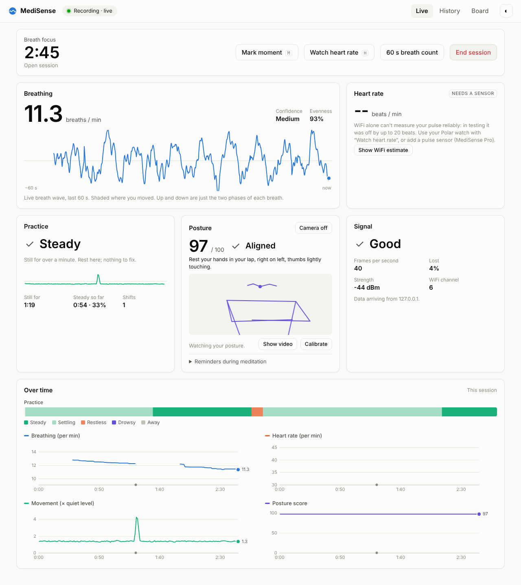
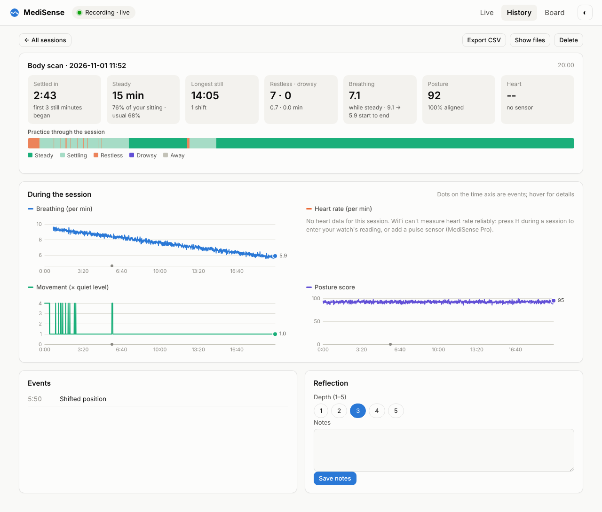

# MediSense

See your breathing, stillness and posture while you meditate, without wearing
anything, and see where your practice is going. A small ESP32-S3 board (about
$15) listens to how your home WiFi signal bends around your body
([RuView](https://github.com/ruvnet/RuView) WiFi sensing); the webcam checks
your posture against the seven points of the Vairocana posture. Your Mac turns
that into live numbers in the browser, records every session, and shows how
quickly you settle, how much of each sitting is steady, and whether
restlessness or dullness is your main obstacle.



Three apps share one install:

| App | What it's for |
|---|---|
| **MediSense** | Meditation sessions: breathing, stillness, posture, practice insights |
| **MediSense Posture** | All-day posture reminders (macOS notifications), camera in the background |
| **MediSense Pro** | MediSense plus a 60 GHz radar and a pulse sensor: exact heart rate, heart-rate variability, coherence |

Everything stays on your Mac. Nothing is uploaded anywhere, and camera images
are never stored.

---

## 1. What you need

- **An ESP32-S3 board**: Espressif **ESP32-S3-DevKitC-1 N16R8** (or N8R8). See
  [docs/HARDWARE.md](docs/HARDWARE.md) for exact models and what to avoid.
- **A USB data cable that fits your Mac.** A MacBook Pro 2014 has the large,
  rectangular USB-A ports, so you need a **USB-A to USB-C data cable** (for
  newer DevKitC boards; older ones use micro-USB). Charge-only cables don't
  work.
- **WiFi with a 2.4 GHz network**. Almost every home router has one. The Mac
  must be on the same WiFi.
- Optional: your Polar watch, to check against, and a webcam for posture (the
  Mac's built-in one is fine).
- Optional, for MediSense Pro: an HLK-LD6002 radar and a MAX30102 pulse sensor
  (about $15 together), see [docs/HARDWARE.md](docs/HARDWARE.md#medisense-pro-a-radar-and-a-pulse-sensor).

You can install and try MediSense **before the board arrives** (demo mode).

## 2. Install (once)

1. Log in to GitHub in your browser, open
   [github.com/roman-spix/medisense](https://github.com/roman-spix/medisense),
   click the green **Code** button, then **Download ZIP**. Safari unzips it into
   your Downloads folder.
2. Open **Terminal** (press ⌘-Space, type *Terminal*, press Return) and paste:

   ```
   bash ~/Downloads/medisense-main/install.sh
   ```

   If the folder in Downloads has a different name, type `bash ` and drag the
   `install.sh` file from that folder into the Terminal window, then press Return.

If macOS asks whether Terminal may access files in your Downloads (or later
Desktop) folder, click **OK**. The installer takes a few minutes. It needs no
administrator password and installs nothing system-wide:

- it moves MediSense to `~/Applications/MediSense`
- it installs its own private Python, leaving the Mac's old one alone
- it installs the posture camera engine (MediaPipe) for background posture
- it puts four icons on your Desktop: **MediSense**, **MediSense Demo**,
  **MediSense Posture** and **MediSense Pro**

(Alternative: double-click **Install MediSense.command** in the folder. If macOS
says it can't be opened, right-click it, choose **Open**, then **Open** again.)

## 3. Try the demo

Double-click **MediSense Demo** on the Desktop. A Terminal window opens (keep it
open; closing it quits MediSense) and the dashboard opens in your browser at
`http://localhost:8765`. A simulated meditator breathes slower and slower, and
shifts position now and then. Start a session, press **M** to mark a moment, end
it, and look at the History tab. In Terminal, `medisense pro --demo` also
simulates the radar and pulse sensor.

## 4. First time with the board

1. Double-click **MediSense** on the Desktop.
2. Plug the board into the Mac. On a DevKitC either USB port works; the one
   labelled **USB** needs no driver.
3. MediSense finds the board within a few seconds and asks for your WiFi
   password. The WiFi name is filled in from what your Mac uses. Click
   **Set up board**.
4. It installs the firmware (about a minute, only once per board), restarts the
   board, and waits for it to join your WiFi. When the data arrives, the badge at
   the top turns green: **Live**.

From then on it's plug and play: plug the board in, open MediSense, and it's
live within seconds. The board can also run from any USB phone charger
elsewhere in the room. The data travels over WiFi, and USB is only needed for
setup.

If something goes wrong, MediSense says what and how to fix it (wrong password,
a 5 GHz-only network, the macOS firewall…). The **Board** tab shows details and
the board's own log.

## 5. Meditating with MediSense

- **Place the board 1–2 m from you**, about chest height, ideally with you
  between the board and the router. Sit still for the first minute: the first
  breathing number takes about 40 seconds of quiet.
- On the Live tab, choose the practice and duration, optionally an intention,
  and tick **Watch my posture with the webcam** if you like. Click
  **Start session**. A soft bell rings at the start, and again when the time
  is up.
- The first time with the camera, sit in your best posture and click
  **Calibrate** on the Posture card: MediSense then measures drift from *your*
  posture. If you drift for 30 seconds, a gentle macOS notification names
  what to correct (adjustable under "Reminders during meditation").
- During the session:
  - **Mark moment** (key **M**): note when something happened, such as
    drowsiness, a breakthrough or a distraction.
  - **Watch heart rate** (key **H**): type what your Polar shows.
  - **60 s breath count**: count your breaths for a minute, as a check of the
    breathing number.
- **End session**: rate the depth (1–5), how you feel, the Polar average and
  notes. You then see the session summary.

What the cards show:

| Card | What it shows | How reliable |
|---|---|---|
| Breathing | Breaths per minute, a live breath wave, how even your breaths are | Good when you sit still and the signal is good |
| Practice | **Steady** (still for over a minute), **Settling**, **Restless**, **Drowsy** (head dropping or nodding, with the camera) or **Away**; how long you've been still; steady time so far | Good |
| Posture | Score 0–100 against the seven-point Vairocana posture, what to correct, and a reminder if you drift | Good when head and shoulders are in view; eyes and mouth can't be checked |
| Heart rate | Only from a pulse sensor or radar (MediSense Pro). WiFi's own estimate is hidden behind "Show WiFi estimate": in testing it was off by up to 20 beats | — |
| Signal | How much data the board delivers, and "Paused" while it reconnects | n/a |

### Where your practice is

Heart and breathing numbers alone don't say how your practice is going. The
**History** tab does, from what the sensors can see of the body:

- **Time to settle**: when your first three still minutes in a row began.
- **Steady**: the share of the sitting spent still for over a minute.
- **Longest still** stretch, and how often you were **restless** (fidgeting,
  the body's side of agitation) or **drowsy** (the head dropping or nodding,
  the body's side of dullness).
- **Breathing while steady**, which usually slows as practice deepens.

**Where you are now** compares your last seven sessions with the seven before:
a stage (Building the habit → Settling the body → Steadying → Stable sitting),
which obstacle shows more (restlessness or dullness), and two or three
specific suggestions. Each session's detail view has a timeline of these
states. The sensors see the body, not the mind: treat this as a mirror for
the conditions of practice; your own notes and ratings remain the real record.



## MediSense Posture (all day)

Double-click **MediSense Posture**. It watches your posture with the camera in
the background (the page can be closed; keep the Terminal window open or
minimised) and sends a macOS notification when your posture stays below your
threshold (default: below 80 for 20 seconds, at most every 3 minutes). Choose
**Meditation** or **Desk** mode, calibrate once, and see your day as a chart.
The first time, macOS asks to allow the camera for Terminal and notifications
for Script Editor (System Preferences → Notifications). To have it start at
login, add **MediSense Posture.command** in System Preferences → Users &
Groups → Login Items.

## MediSense Pro

With an HLK-LD6002 radar and a MAX30102 pulse sensor wired to the board
([wiring](docs/HARDWARE.md#medisense-pro-a-radar-and-a-pulse-sensor)),
double-click **MediSense Pro**. The board's firmware is updated automatically
the next time it's plugged in. You get an exact heart rate, heart-rate
variability (RMSSD, SDNN), **coherence** (how much of your heart rhythm follows
one slow rhythm, usually your breathing) and radar breathing. MediSense uses
the best source for each number.

## 6. Your data

Each session is a folder in `~/MediSense/sessions/` (**Show files** in the
History tab opens it):

| File | Contents |
|---|---|
| `session.json` | Date, practice, intention, rating, notes, summary numbers |
| `metrics.csv` | One row per second: breathing, heart rate, movement, posture (opens in Numbers/Excel) |
| `wave.csv` | Breath wave and movement, 10 rows per second |
| `posture.csv` | Posture score and each check's measurement twice a second (numbers only, no images) |
| `events.jsonl` | Shifts, marks, watch readings, breath counts, nods, posture reminders, board interruptions |
| `board.log` | The board's own log, when it was plugged into the Mac (explains interruptions) |
| `raw.mscap.gz` | Everything the board sent, so sessions can be re-analysed with better algorithms later (`medisense reprocess <session>`) |

Deleting a session in the app moves it to `~/MediSense/trash`.

## 7. Troubleshooting

| What you see | What to do |
|---|---|
| "No board" though it's plugged in | Try the other USB port on the board or another cable (some are charge-only). |
| "The board didn't answer" while setting up | Hold **BOOT** on the board, press and release **RESET**, release **BOOT**, then unplug and replug. |
| "The WiFi password seems to be wrong" | Type it again in the form shown. Passwords are case-sensitive. |
| "Can't find that WiFi network" | The board needs 2.4 GHz. If your router names 2.4 and 5 GHz differently, pick the 2.4 GHz name. |
| "On WiFi but no data reaches this Mac" | Same WiFi on the Mac? macOS firewall: System Preferences → Security & Privacy → Firewall. Allow Python, or turn off "Block all incoming connections". |
| Signal "Weak" | Move the board closer to the router, away from metal and other electronics. |
| Breathing shows "--" for long | Sit still. Move the board so your chest is between it and the router. |
| Camera posture doesn't start | System Preferences → Security & Privacy → Camera: allow **Terminal** (background engine). Without the engine, posture uses the browser's camera: allow it when the browser asks. |
| No posture notifications | System Preferences → Notifications → **Script Editor** → Allow Notifications. Test it with **Send a test notification** in MediSense Posture. |
| Data keeps pausing | Plug the board into the Mac during a session: the Board tab's **Interruptions** list then says why (WiFi drop with a reason code, power dip, restart). |
| macOS asks if "python3.12" may accept incoming connections | Click **Allow**: that's the board's data arriving. |

Run a self-check any time in Terminal: `~/Applications/MediSense/.venv/bin/medisense doctor`

## 8. Updating and removing

**Update:** download the new ZIP and run `install.sh` from it again, the same way
as installing. Your recordings and board setup are kept.

**Remove:** delete `~/Applications/MediSense`, `~/.medisense` and the four
Desktop icons. Your recordings stay in `~/MediSense` until you delete that too.

## 9. How it works, and its limits

The board joins your WiFi and measures the radio channel ("CSI") from frames
your router sends to it, up to 50 times a second. Breathing moves your chest
by millimetres, which changes how the signal reflects. MediSense finds the
breathing period from how the signal repeats (robust to the strong harmonics
of slow breathing), measures movement against each subcarrier's own quiet
level, and bridges short dropouts. With one board, stillness and breathing
are solid; the heartbeat is too small a movement, so heart rate needs a pulse
sensor or radar. WiFi can't see your skeleton, which is why posture uses the
camera. Details: [docs/HOW-IT-WORKS.md](docs/HOW-IT-WORKS.md).

MediSense is a meditation aid, not a medical device.

## For developers

```
bash install.sh                    # or: uv venv && uv pip install -e ".[dev]"
.venv/bin/pytest                   # analysis accuracy, insights, posture, Pro sensors, board lifecycle, API
.venv/bin/medisense demo           # run with the simulator
.venv/bin/medisense --help         # start | demo | pro | posture | doctor | sessions | reprocess | fetch-assets
```

Layout: `src/medisense/` (Python app), `src/medisense/web/` (pages, no build
step), `firmware/` (prebuilt RuView firmware, the MediSense patches and how it
was built), `tests/`. The posture camera engine runs in its own environment
(`.venv-posture`, `requirements-posture-macos.txt`).

## Credits and licences

- [RuView](https://github.com/ruvnet/RuView) (MIT): the ESP32 CSI firmware.
- [MediaPipe](https://github.com/google-ai-edge/mediapipe) (Apache-2.0): camera
  pose (the background engine and the browser fallback).
- [esptool](https://github.com/espressif/esptool) (GPL-2.0-or-later): used as a
  separate program to install the firmware. Check its licence terms before
  shipping MediSense commercially.
- numpy, aiohttp, pyserial, ESP-IDF NVS tools (BSD/Apache/MIT).
